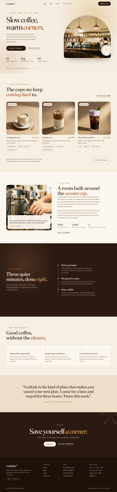
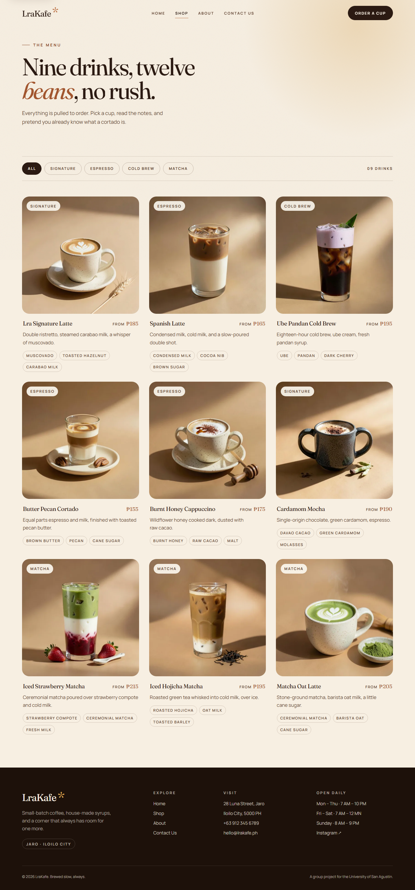
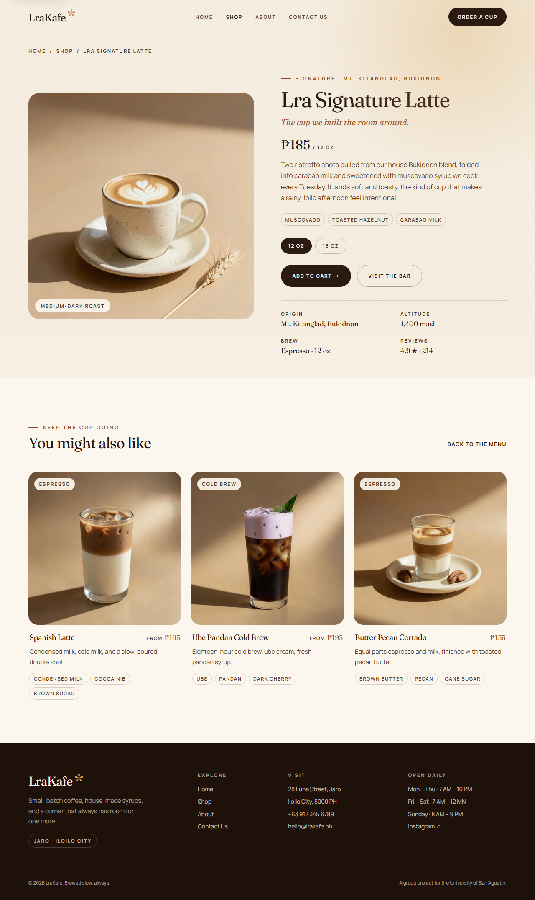
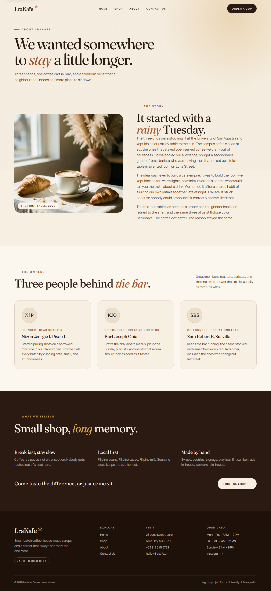
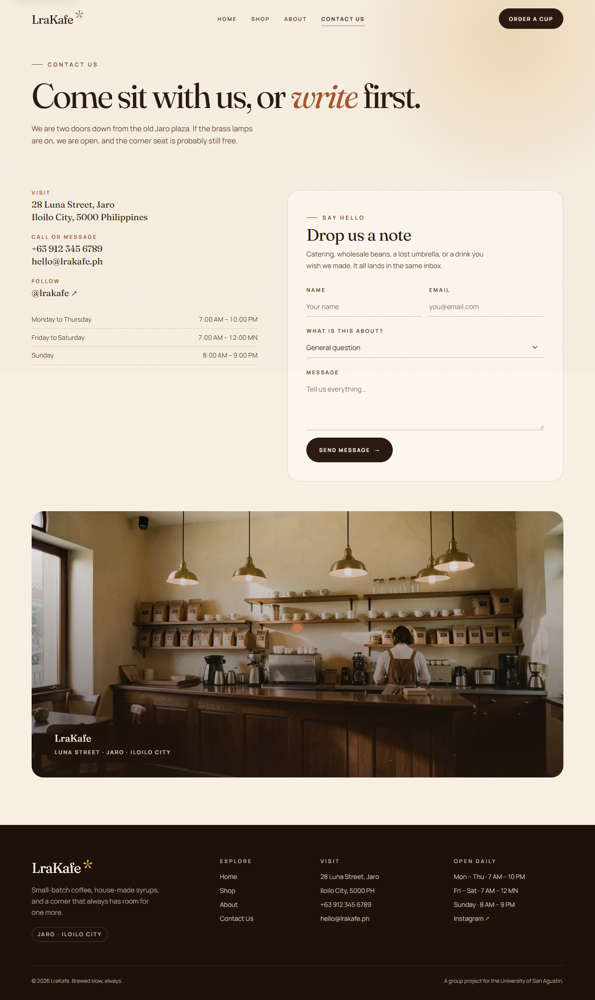

# LraKafe

A warm editorial storefront for a small-batch coffee bar in Jaro, Iloilo City. Built with React 19, Vite, React-Bootstrap and React Router.

## Screenshots

Full-page captures of every route. Select an image to open it at full resolution.

<table>
  <tr>
    <td align="center" valign="top">
      
       
      <b>Home</b>
    </td>
    <td align="center" valign="top">
      
       
      <b>Shop</b>
    </td>
  </tr>
  <tr>
    <td align="center" valign="top">
      
       
      <b>Product detail</b>
    </td>
    <td align="center" valign="top">
      
       
      <b>About</b>
    </td>
  </tr>
  <tr>
    <td align="center" valign="top">
      
       
      <b>Contact</b>
    </td>
    <td></td>
  </tr>
</table>
